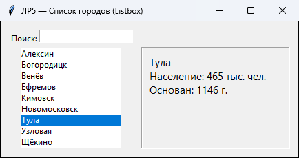
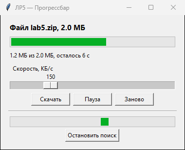
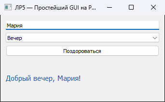
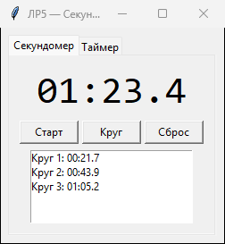
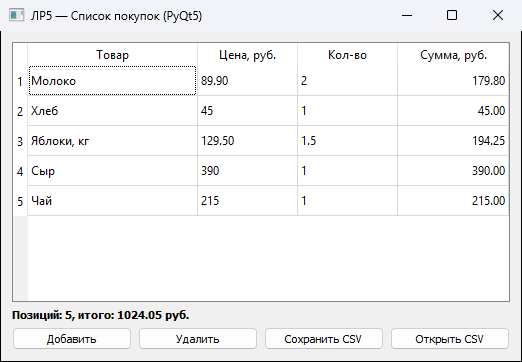

# Лабораторная работа №5. Визуальное программирование на Python

**Двикалюк Мария Викторовна, группа 220042-11, вариант 4, лабораторная №5**

Дисциплина «Методы и технологии программирования» (часть 1).

## Задания варианта 4

| Сложность | № | Задание | Файл | Библиотека |
|---|---|---|---|---|
| Средняя | 4 | Список (Listbox) и выбор элемента | `listbox_pick.py` | Tkinter |
| Средняя | 6 | Прогрессбар | `progress.py` | Tkinter (ttk) |
| Средняя | 10 | Простейший GUI на PyQt5 | `qt_hello.py` | PyQt5 |
| Повышенная | 5 | Программа таймер/секундомер | `stopwatch.py` | Tkinter |
| Повышенная | 9 | Приложение PyQt с таблицей | `qt_table.py` | PyQt5 |

Каждое задание — отдельный скрипт, `menu.py` запускает любое из них,
`check.py` прогоняет примеры-тесты из docstring (окна при этом не
открываются — проверяется логика, вынесенная в функции).

```bash
pip install -r requirements.txt
python menu.py
python stopwatch.py
python check.py
```

## Средняя 4. Список и выбор элемента

Города Тульской области в `Listbox`: событие `<<ListboxSelect>>`
выводит сведения о выбранном городе, поле поиска фильтрует список по
мере ввода (`trace_add` на переменной поля):



## Средняя 6. Прогрессбар

«Скачивание» файла: скорость задаётся ползунком `Scale`, полоса
`ttk.Progressbar` и оставшееся время обновляются через `after()`.
Нижняя полоса в режиме `indeterminate` показывает поиск, длительность
которого заранее неизвестна:



## Средняя 10. Простейший GUI на PyQt5

`QLineEdit`, `QComboBox`, `QPushButton` и `QLabel` в вертикальной
компоновке; сигнал `clicked` (и `returnPressed` в поле) подключён к
методу, формирующему приветствие:



## Повышенная 5. Таймер и секундомер

Две вкладки `ttk.Notebook`. Секундомер — старт/стоп, круги, сброс;
время считается по `time.perf_counter()`, а не по числу срабатываний
`after()`, поэтому не накапливает ошибку. Таймер принимает время в
формате «ММ:СС» или в минутах и по окончании подаёт сигнал:



## Повышенная 9. Приложение PyQt с таблицей

Список покупок на `QTableWidget`: цена и количество редактируются в
таблице, столбец «Сумма» (только для чтения) и итог пересчитываются
по сигналу `itemChanged`. Таблицу можно сохранить в CSV и открыть
снова через `QFileDialog`:



## Проверка

```
$ python check.py
listbox_pick  примеров:  3  OK
progress      примеров:  3  OK
qt_hello      примеров:  2  OK
stopwatch     примеров:  5  OK
qt_table      примеров:  3  OK
Всего примеров: 16, провалено: 0
```
